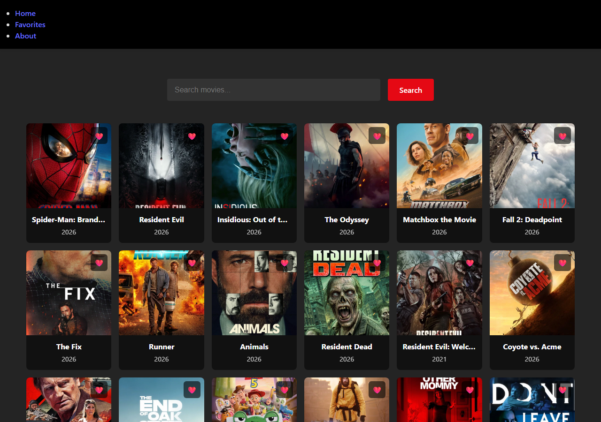
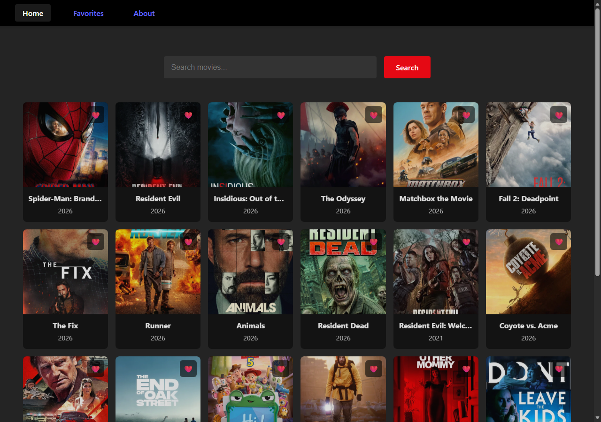

# Movies Library

A movie browser built with **Angular 22** and **TypeScript**. It shows today's popular movies, lets you search [The Movie Database (TMDB)](https://www.themoviedb.org/), and keeps a list of favorites in your browser.

The project was originally a React 19 app and was migrated to Angular as an engineering exercise: same features and look, new architecture, tests added. See [docs/MIGRATION.md](docs/MIGRATION.md) for the full story and [docs/ANGULAR_GUIDE.md](docs/ANGULAR_GUIDE.md) for a guide to how Angular works and how this codebase is put together.

| React original                                                     | Angular                                                                |
| ------------------------------------------------------------------ | ---------------------------------------------------------------------- |
|  |  |

The original's navbar rendered as a bulleted list and its phone layout overflowed; both are fixed in the Angular version (see [mobile screenshot](docs/screenshots/angular-home-mobile.png)).

## Features

- **Popular movies** on the home page, loaded from TMDB.
- **Search** by title. Slow earlier searches can never overwrite newer ones.
- **Favorites**: toggle the heart on any card. Favorites persist in `localStorage` and have their own page.
- Loading, error and "no results" states; a 404 page; per-page document titles.
- Responsive layout (checked at 1280px and 390px) and an accessibility pass (labelled controls, ARIA states, heading order; axe-core reports no violations).

## Tech stack

Angular 22 (standalone components, signals, zoneless), TypeScript 6 (strict), RxJS 7, Angular Router, `HttpClient`, Reactive Forms, Vitest, ESLint (angular-eslint) and Prettier. Plain CSS with design tokens: no UI library.

## Getting started

**Prerequisites:** Node.js `^22.22.3` or `^24.15.0` (required by Angular 22) and npm 11.

```bash
npm ci
npm start          # http://localhost:4200
```

| Command                                   | Purpose                                                              |
| ----------------------------------------- | -------------------------------------------------------------------- |
| `npm start`                               | Dev server with live reload                                          |
| `npm test -- --watch=false`               | Run the unit and component tests once (omit the flag for watch mode) |
| `npm run lint`                            | ESLint, including template accessibility rules                       |
| `npm run format` / `npm run format:check` | Prettier                                                             |
| `npm run build`                           | Production build into `dist/movies-library/browser`                  |

## Architecture

```text
src/app/
  core/       UI-free singletons: TmdbApiService, FavoritesStore, NotificationService, TMDB_CONFIG
  shared/     MovieCard (presentational), MovieGrid, models, TMDB-to-Movie mapper
  layout/     Navbar
  features/   home, favorites, about, not-found (lazy-loaded routes)
  app.ts / app.routes.ts / app.config.ts
```

- **State** lives in signals inside services (`FavoritesStore`); components read them in templates. There is no state library; the app has one shared piece of state.
- **Async** work is RxJS: `TmdbApiService` returns observables, and Home turns a `switchMap` pipeline into a signal with `toSignal`.
- **Components** are standalone. `MovieCard` has inputs and outputs only; `MovieGrid` wires favorites; pages compose them.
- **Routes** are lazy-loaded with `loadComponent`.

A dependency diagram and end-to-end walkthroughs (startup, search, favoriting) are in the [Angular guide](docs/ANGULAR_GUIDE.md#13-how-this-project-works-end-to-end).

## Testing

`npm test -- --watch=false` runs **54 tests in 11 files** with Vitest: the TMDB mapper, the HTTP service (via `HttpTestingController`), the favorites store (persistence, corrupt storage, survives reload), components (rendering, ARIA state, events), the pages' loading/error/empty states and the stale-search race, and the routes. The two key regression tests were checked by deliberately reintroducing the bugs and watching them fail.

Beyond the unit tests, the app was exercised in headless Edge against the live TMDB API (dev server and production build) and scanned with axe-core. What was and was not verified is spelled out in [docs/MIGRATION.md](docs/MIGRATION.md#6-testing-and-validation-performed). There is no end-to-end suite or CI in the repository yet.

## Deployment

`npm run build` produces static files in `dist/movies-library/browser`. Host them on any static host, and configure it to **serve `index.html` for unknown paths** (SPA fallback), otherwise opening `/favorites` directly returns a 404. If the app is served from a sub-path, build with `ng build --base-href /your-path/`.

## Known limitations

- The TMDB API key is in the source (`src/app/core/config/tmdb.config.ts`) and was already in the original repository's history. Any key shipped to a browser is readable, so rotate it and, for a real deployment, proxy TMDB through a small backend.
- Only the first page of TMDB results is shown.
- Favorites announce their state to screen readers, but the ❤️ looks the same whether or not a movie is a favorite (inherited from the original).
- Favorite changes use a blocking `alert()`, as in the original; `NotificationService` is the single place to change that.
- The Angular bundle is larger than the React one (see the numbers in the migration notes). Tested in Chromium only.

## Attribution

This product uses the TMDB API but is not endorsed or certified by TMDB.
