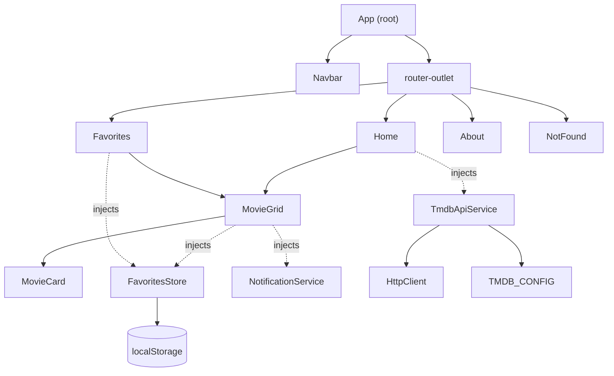

# Angular Guide: the core ideas, and how this project uses them

This guide explains how Angular works and then walks through this project with Angular's own vocabulary. It assumes you know React (the project began as a React app) and have not used Angular before. Every code example is taken from this repository, so you can open the file and follow along.

> Versions used here: Angular 22, TypeScript 6, RxJS 7, Vitest. Angular has changed a lot in recent years. Older tutorials teach `NgModule`s, `*ngIf`, `zone.js` and constructor injection; this project uses none of those. If a tutorial disagrees with this guide, trust this guide and the [official docs](https://angular.dev).

---

## 1. The big picture

Angular is a **framework**: it ships with a router, an HTTP client, a forms library, dependency injection and a test setup, all designed to work together. React is a **library** for building UI; routing, data fetching and so on come from other packages you choose.

| Concern                        | React (the old version of this app)   | Angular (this app)                                                          |
| ------------------------------ | ------------------------------------- | --------------------------------------------------------------------------- |
| UI unit                        | Function component returning JSX      | Class decorated with `@Component`, with an HTML template                    |
| Local state                    | `useState`                            | `signal()`                                                                  |
| Derived values                 | `useMemo` / recomputing in render     | `computed()`                                                                |
| Props                          | Function arguments                    | `input()` (a signal)                                                        |
| Callbacks to parent            | A function passed as a prop           | `output()` (an event emitter)                                               |
| Shared state                   | Context + `useContext`                | A service injected with `inject()`                                          |
| Side effects / data loading    | `useEffect`                           | Services returning RxJS `Observable`s; `toSignal` to use them in a template |
| Routing                        | `react-router-dom`                    | `@angular/router` (built in)                                                |
| HTTP                           | `fetch` wrapped by hand               | `HttpClient` (built in)                                                     |
| Forms                          | Controlled inputs                     | Reactive Forms (`FormControl`, `FormGroup`)                                 |
| Conditionals / loops in markup | `{cond && ...}`, `.map()`             | `@if`, `@for` in the template                                               |
| CSS                            | Global CSS files you import           | Styles scoped to each component by default                                  |
| Re-rendering                   | Re-runs your function on state change | Updates only the template bindings whose signals changed                    |

The biggest mental shift: **a React component function runs again on every render; an Angular component class is created once**, and its template is a set of live bindings that update themselves when the signals they read change. There is no "render function" to re-run, so there are no stale closures or dependency arrays to get wrong.

---

## 2. Application startup

[src/main.ts](../src/main.ts) is the entry point:

```ts
bootstrapApplication(App, appConfig).catch((err) => console.error(err));
```

This says: "start the app with `App` as the root component and this configuration." The configuration is [src/app/app.config.ts](../src/app/app.config.ts):

```ts
export const appConfig: ApplicationConfig = {
  providers: [
    provideBrowserGlobalErrorListeners(),
    provideRouter(routes),
    provideHttpClient(withFetch()),
  ],
};
```

Each `provide...()` call switches on a capability for the whole app: routing, HTTP (using the browser's `fetch`), and global error reporting. This is **dependency injection configuration** (section 6). It is the Angular equivalent of wrapping your React tree in providers (`<BrowserRouter>`, `<MovieProvider>`), but done in one place and not nested in JSX.

[src/index.html](../src/index.html) contains `<app-root></app-root>`. That tag is the selector of the root component, and Angular renders into it, like `<div id="root">` in React.

This project does not use `zone.js` (it is not in `package.json`); it was created with `ng new --zoneless`. Traditionally, Angular used `zone.js` to patch browser APIs and re-check the component tree after every async event. A **zoneless** app instead updates the screen when something it depends on notifies Angular, such as a signal read by a template changing, or a template event listener firing. That is why signals matter so much in this codebase.

---

## 3. Components

A component is a class plus a template plus (optionally) styles. Here is the whole of [movie-card.ts](../src/app/shared/components/movie-card/movie-card.ts):

```ts
@Component({
  selector: 'app-movie-card', // the HTML tag: <app-movie-card>
  styleUrl: './movie-card.css', // styles for this component only
  templateUrl: './movie-card.html', // its template
})
export class MovieCard {
  readonly movie = input.required<Movie>(); // data in
  readonly favorite = input(false); // data in, with a default
  readonly favoriteToggle = output<void>(); // event out

  protected readonly favoriteLabel = computed(
    () => `${this.favorite() ? 'Remove' : 'Add'} ${this.movie().title} ...`,
  );
}
```

Key points:

- **`@Component({...})`** is a decorator that attaches metadata to the class. `selector` is how other templates use it.
- **Standalone.** A component declares what it uses in its own `imports: [...]`. For example, [movie-grid.ts](../src/app/shared/components/movie-grid/movie-grid.ts) has `imports: [MovieCard]` because its template uses `<app-movie-card>`. If you forget, the compiler tells you. (Older Angular required `NgModule`s for this; they are not used here.)
- **`protected` / `readonly`.** Members used only by the template are `protected`; inputs and outputs are public because parents bind to them.
- **Naming.** Files are named without a suffix (`movie-card.ts` holds the class `MovieCard`). This is the current official style guide.

### Inputs and outputs (props and callbacks)

```html
<!-- in movie-grid.html -->
<app-movie-card
  [movie]="movie"                                  <!-- property binding: parent -> child -->
  [favorite]="favorites.isFavorite(movie.id)"
  (favoriteToggle)="toggleFavorite(movie)"         <!-- event binding: child -> parent -->
/>
```

- `[x]="expr"` sends a value in. In the child it arrives as an **input signal**, which you read by calling it: `movie()`.
- `(x)="statement"` listens for an event. In the child, `favoriteToggle.emit()` triggers it.

`MovieCard` is a **presentational component**: it owns no state, calls no services, and only shows what it is given and reports clicks. That makes it trivial to test and reuse. The parent, `MovieGrid`, is where behavior is wired up.

### Styles are scoped

CSS in `movie-card.css` only affects `MovieCard`'s own template. Angular does this by adding unique attributes (you will see things like `_ngcontent-ng-c123456` in the browser's DevTools) and rewriting the selectors to match. This replaces the React app's problem of every CSS file being global and files overriding each other by import order (see [MIGRATION.md](MIGRATION.md)). Truly global styles (the reset, design tokens) live in [src/styles.css](../src/styles.css).

---

## 4. Templates

A template is HTML plus a few Angular extras.

| Syntax                       | Meaning                                                   | Example in this project                  |
| ---------------------------- | --------------------------------------------------------- | ---------------------------------------- |
| `{{ expr }}`                 | Show a value (escaped, so it is safe from HTML injection) | `{{ movie().title }}`                    |
| `[prop]="expr"`              | Set a DOM property or input                               | `[src]="posterUrl"`                      |
| `[attr.x]="expr"`            | Set an HTML attribute                                     | `[attr.aria-label]="favoriteLabel()"`    |
| `[class.x]="cond"`           | Toggle a CSS class                                        | `[class.active]="favorite()"`            |
| `(event)="stmt"`             | Handle an event                                           | `(click)="favoriteToggle.emit()"`        |
| `@if` / `@else`              | Conditional                                               | see below                                |
| `@for (x of xs; track x.id)` | Loop (the `track` is required: it is React's `key`)       | `movie-grid.html`                        |
| `@let name = expr;`          | Name a value inside a template                            | `@let current = state();` in `home.html` |

From [home.html](../src/app/features/home/home.html):

```html
@let current = state(); @if (current.status === 'loading') {
<div class="status loading" role="status">Loading...</div>
} @else if (current.status === 'error') {
<div class="status error-message" role="alert">{{ current.message }}</div>
} @else if (current.movies.length === 0) {
<div class="status" role="status">No movies found.</div>
} @else {
<app-movie-grid [movies]="current.movies" />
}
```

Notice that inside the final `@else`, TypeScript knows `current.movies` exists, because the earlier branches ruled out `loading` and `error`. The template is **type-checked** (we enable `strictTemplates`), so a typo here fails the build instead of failing in a user's browser.

---

## 5. Signals: Angular's reactive state

A signal is a box holding a value that notifies anything reading it when it changes.

```ts
const count = signal(0); // create
count(); // read: you CALL it
count.set(5); // replace
count.update((n) => n + 1); // derive from the previous value

const double = computed(() => count() * 2); // derived; recalculated only when count changes
```

Three rules that cover most uses:

1. **Reading a signal inside a template or a `computed` subscribes to it automatically.** There is no dependency array.
2. **`computed` values are read-only, cached and lazy.** They only recalculate when something they read changed _and_ someone reads them.
3. **Treat signal values as immutable.** To "change" a list, `set` a new array (`[...old, item]`), as [FavoritesStore](../src/app/core/services/favorites.store.ts) does.

A real example, from `FavoritesStore`:

```ts
private readonly state = signal<readonly Movie[]>(this.load());

readonly favorites = this.state.asReadonly();                         // expose read-only
readonly count = computed(() => this.state().length);
private readonly ids = computed(() => new Set(this.state().map((m) => m.id)));

isFavorite(movieId: number): boolean {
  return this.ids().has(movieId);        // read inside a template => the template stays in sync
}
```

When `MovieGrid`'s template calls `favorites.isFavorite(movie.id)`, it reads the `ids` computed, which reads `state`. When `state` is `set`, Angular knows exactly which bindings depend on it and updates only those. Nothing re-runs a component function.

---

## 6. Dependency injection (DI)

DI means a class _asks_ for what it needs and Angular supplies it, instead of the class creating or importing a global instance.

```ts
@Injectable({ providedIn: 'root' })        // one shared instance for the whole app
export class TmdbApiService {
  private readonly http = inject(HttpClient);
  private readonly config = inject(TMDB_CONFIG);
  ...
}
```

- **`inject(Something)`** asks the injector for it. It works in field initializers and constructors (an "injection context").
- **`providedIn: 'root'`** makes the service a singleton. Any component that does `inject(FavoritesStore)` gets the _same_ instance, which is how Home and Favorites share data. This is what React Context did in the old app, with far less ceremony.
- **`InjectionToken`** injects things that are not classes, like configuration. See [tmdb.config.ts](../src/app/core/config/tmdb.config.ts): `TMDB_CONFIG` holds the API URL and key.

### Why DI is worth it: testing

Because classes ask for their dependencies, a test can hand them different ones:

```ts
TestBed.configureTestingModule({
  providers: [{ provide: TmdbApiService, useValue: fakeApi }], // Home now talks to a fake
});
```

[home.spec.ts](../src/app/features/home/home.spec.ts) does exactly this to control when "responses" arrive and prove that a slow old search can't overwrite a newer one. No network, no mocking of globals.

---

## 7. Services: where logic lives

The rule used here: **components describe the screen; services hold behavior and data.**

| Service                                                                 | Responsibility                                                                                         |
| ----------------------------------------------------------------------- | ------------------------------------------------------------------------------------------------------ |
| [TmdbApiService](../src/app/core/services/tmdb-api.service.ts)          | Talks to TMDB over HTTP and returns `Movie` objects. Knows nothing about the UI.                       |
| [FavoritesStore](../src/app/core/services/favorites.store.ts)           | Owns the favorites list and its localStorage persistence. Knows nothing about the UI.                  |
| [NotificationService](../src/app/core/services/notification.service.ts) | Shows messages to the user. Today it uses `alert()`; replacing it with a toast changes only this file. |

Pure helper functions that need no Angular at all (like [tmdb-mapper.ts](../src/app/shared/utils/tmdb-mapper.ts), which converts TMDB's JSON into a `Movie`) are plain TypeScript, which makes them the easiest things to test.

---

## 8. RxJS and Observables

Signals hold a _current value_. **Observables** (from RxJS) describe a _stream of values over time_: an HTTP response, a user typing, a timer. Angular's `HttpClient` returns observables.

An observable is **lazy**: nothing happens until something `subscribe`s. When the subscriber goes away (`unsubscribe`), the work is cancelled. For HTTP that means the in-flight request is aborted. This matters below.

Operators are small functions that transform a stream, chained with `.pipe(...)`:

| Operator     | What it does                                                                 | Where it is used                                        |
| ------------ | ---------------------------------------------------------------------------- | ------------------------------------------------------- |
| `map`        | Transform each value                                                         | `TmdbApiService` turns the TMDB response into `Movie[]` |
| `startWith`  | Emit a value first                                                           | Emit "loading" immediately; trigger the first load      |
| `switchMap`  | For each new input, start a new inner stream and **cancel the previous one** | Home's search                                           |
| `catchError` | Turn a failure into a normal value                                           | Show an error message instead of crashing the stream    |

### Walkthrough: the Home page pipeline

From [home.ts](../src/app/features/home/home.ts):

```ts
protected readonly state = toSignal(
  this.searches.pipe(                 // 1. a Subject that emits each submitted query
    startWith(null),                  // 2. also emit once at start, to load popular movies
    switchMap((query) => this.load(query)),   // 3. for each emission, run a request
  ),
  { initialValue: LOADING },          // 4. what the signal holds before anything arrives
);
```

and `load()`:

```ts
return request.pipe(
  map((movies) => ({ status: 'loaded', movies })), // success -> a 'loaded' state
  startWith(LOADING), // show "Loading..." right away
  catchError(() => of({ status: 'error', message })), // failure -> an 'error' state
);
```

Timeline when the user searches twice quickly:

```
submit "first"   -> request A starts, state = loading
submit "second"  -> switchMap CANCELS request A, starts request B, state = loading
B responds       -> state = loaded(B's movies)
(A's response never arrives; it was cancelled)
```

This is why a stale response can no longer overwrite a fresh one (a bug class that is easy to hit with `useEffect` + `fetch` unless you add cancellation by hand).

**`toSignal`** is the bridge: it subscribes to the observable, keeps the latest value in a signal, and automatically unsubscribes when the component is destroyed. After that the template just reads `state()` like any signal.

Rule of thumb used here: **observables for async work and streams, signals for state that templates read.** `toSignal` connects them.

---

## 9. Forms

Home's search box uses **Reactive Forms**: the form's state lives in TypeScript objects, not in the template.

```ts
protected readonly form = new FormGroup({
  query: new FormControl('', { nonNullable: true }),
});
```

```html
<form [formGroup]="form" (ngSubmit)="onSearch()">
  <input formControlName="query" ... />
</form>
```

`formGroup` / `formControlName` connect the HTML to the objects; `(ngSubmit)` fires on submit and prevents the browser's default page reload for you. Read the value anywhere with `this.form.controls.query.value` (typed as `string`, thanks to `nonNullable`). Reactive Forms scale to validation, dynamic fields and async validators; this app only needs the basics.

---

## 10. Routing

Routes are plain data in [app.routes.ts](../src/app/app.routes.ts):

```ts
{
  path: 'favorites',
  title: 'Favorites | Movie List',
  loadComponent: () => import('./features/favorites/favorites').then((m) => m.Favorites),
},
```

- **`loadComponent` with `import()`** is **lazy loading**: the Favorites code is a separate file downloaded only when the user first visits that route. You can see the separate chunks in the `ng build` output.
- **`title`** sets the browser tab title on navigation (and helps screen readers announce the page change).
- **`path: '**'`** is the catch-all, used for the 404 page.
- [app.html](../src/app/app.html) places `<router-outlet />` where the current page appears.
- In templates, `routerLink="/favorites"` replaces `<Link to=...>`, and `routerLinkActive="active"` adds a class when that link's route is current ([navbar.html](../src/app/layout/navbar/navbar.html)).

---

## 11. HTTP

`provideHttpClient(withFetch())` (in `app.config.ts`) makes `HttpClient` injectable. Using it:

```ts
this.http.get<TmdbPageDto>(url, { params: { api_key: key, query } });
```

- The generic `<TmdbPageDto>` types the response, so everything downstream is type-checked.
- `params` are encoded for you, so a search for `spider man & co` is sent safely (see the test in [tmdb-api.service.spec.ts](../src/app/core/services/tmdb-api.service.spec.ts)).
- It returns an observable and does **not** swallow errors. The Home page decides how to show them. (The React version caught errors inside the API layer and returned `[]`, so the UI could never display them.)

---

## 12. Testing

Tests are `*.spec.ts` files next to the code, run by **Vitest** through `ng test`.

Core tools:

- **`TestBed`** builds a small Angular environment for a test: `TestBed.createComponent(Home)` creates a real component; `TestBed.inject(FavoritesStore)` gets a real service.
- **`fixture.componentRef.setInput('movie', ...)`** sets an input, as a parent would.
- **`await fixture.whenStable()`** waits for Angular to finish updating the DOM. (Zoneless apps update after signals change; you wait for that instead of calling a manual "detect changes".)
- **`provideHttpClientTesting()` + `HttpTestingController`** intercept HTTP calls so a test can say "expect a GET to this URL, and respond with this JSON."
- **Provider overrides** swap real services for fakes (section 6).

Styles of test used here, with examples:

| Kind                        | Example                                                                          | What it proves                                                        |
| --------------------------- | -------------------------------------------------------------------------------- | --------------------------------------------------------------------- |
| Pure function               | [tmdb-mapper.spec.ts](../src/app/shared/utils/tmdb-mapper.spec.ts)               | Missing release dates and posters don't crash or produce a broken URL |
| Service                     | [favorites.store.spec.ts](../src/app/core/services/favorites.store.spec.ts)      | Persistence, corrupt storage, and "favorites survive a reload"        |
| HTTP service                | [tmdb-api.service.spec.ts](../src/app/core/services/tmdb-api.service.spec.ts)    | Right URL, params, mapping, and that errors propagate                 |
| Component                   | [movie-card.spec.ts](../src/app/shared/components/movie-card/movie-card.spec.ts) | Rendered output, accessibility attributes, emitted events             |
| Page with fake dependencies | [home.spec.ts](../src/app/features/home/home.spec.ts)                            | Loading/error/empty states and the stale-search race                  |
| Routing                     | [app.routes.spec.ts](../src/app/app.routes.spec.ts)                              | Lazy routes resolve, titles are set, 404 works                        |

---

## 13. How this project works, end to end

### Structure

```text
src/app/
  core/                 app-wide singletons: things with no UI
    config/tmdb.config.ts        API settings, injected via a token
    services/tmdb-api.service.ts HTTP access to TMDB
    services/favorites.store.ts  favorites state + persistence
    services/notification.service.ts
  shared/               reusable pieces used by several features
    components/movie-card/       presentational card
    components/movie-grid/       grid + favorite-toggle wiring
    models/                      Movie (UI) and TMDB DTO types
    utils/tmdb-mapper.ts         DTO -> Movie
  layout/navbar/        the top navigation bar
  features/             one folder per page / route
    home/  favorites/  about/  not-found/
  app.ts, app.html      root component (navbar + <router-outlet>)
  app.routes.ts         the routes (lazy loaded)
  app.config.ts         app-wide providers
```

### Who depends on whom



Solid arrows are "renders"; dotted arrows are "gets via `inject()`". Note that `Home` never touches favorites and `MovieCard` never touches services.

### Flow 1: opening the app

1. `main.ts` bootstraps `App` with the providers from `app.config.ts`.
2. The router matches `/` and lazily loads `Home`.
3. `Home` is created. Its `state` signal's observable starts: `startWith(null)` triggers `load(null)`, which calls `TmdbApiService.getPopularMovies()`. `state` is `loading`, so the template shows "Loading...".
4. TMDB responds. `TmdbApiService` maps each result with `toMovie`, `Home` maps that to `{status: 'loaded', movies}`, `state` updates, and the template swaps "Loading..." for `<app-movie-grid>`.

### Flow 2: searching

1. The user types. `formControlName="query"` keeps `form.controls.query.value` in sync.
2. Submit fires `(ngSubmit)="onSearch()"`. It trims the text; if blank, it does nothing (as the React version did); otherwise it calls `searches.next(query)`.
3. `switchMap` cancels any request in flight and starts `searchMovies(query)`. The state goes `loading` then `loaded` (or `error`).

### Flow 3: favoriting a movie

1. The user clicks the heart in `MovieCard`; it emits `favoriteToggle`.
2. `MovieGrid.toggleFavorite(movie)` calls `FavoritesStore.toggle(movie)`, which updates the signal and writes to localStorage, then calls `NotificationService.notify(...)`, which shows the alert.
3. Because `state` changed, every template reading `isFavorite(...)` updates: the card's `aria-pressed` and `.active` class flip, and if the Favorites page is open, its list changes.
4. On the next visit, `FavoritesStore` loads the saved list once, when it is first created. It never writes on startup, which is how this version avoids the React version's reload bug.

---

## 14. Commands

| Command                                           | What it does                                             |
| ------------------------------------------------- | -------------------------------------------------------- |
| `npm start`                                       | Dev server at http://localhost:4200 with live reload     |
| `npm test -- --watch=false`                       | Run all tests once (omit the flag to re-run on change)   |
| `npm run lint`                                    | ESLint, including Angular template accessibility rules   |
| `npm run format` / `format:check`                 | Prettier                                                 |
| `npm run build`                                   | Production build into `dist/movies-library/browser`      |
| `npx ng generate component shared/components/foo` | Scaffold a component following the project's conventions |

---

## 15. Learning path, using this codebase

Try these in order; each one exercises one idea:

1. **Signals.** Add a "favorites count" badge to the navbar using `FavoritesStore.count()`. (`count` already exists and is tested.) You will need to `inject` the store in `Navbar` and read the signal in its template.
2. **Inputs/outputs.** Add an `@if` that shows the movie's rating on `MovieCard`: add a field to `Movie`, map it in `toMovie`, and pass it through. Update the mapper test first.
3. **DI.** Replace `alert()` with an inline toast by changing only `NotificationService`. Nothing else should need to change; that is the point of the service.
4. **RxJS.** Add a 300 ms `debounceTime` so the app searches as you type. Where does it go in the pipeline, and why before `switchMap`?
5. **Routing.** Add a `/movie/:id` details route using the `getMovieDetails` call the React app defined but never used. Read the id with `input()` and `withComponentInputBinding()`.
6. **Testing.** For each change, write the failing test first, then make it pass.

---

## 16. Glossary

- **Binding**: a link between the template and the class (`{{ }}`, `[x]`, `(x)`).
- **Change detection**: how Angular decides what to update on screen. Here it is driven by signals (zoneless).
- **Component**: class + template + styles, used as a custom HTML element.
- **DI / injector**: the mechanism that supplies a class's dependencies.
- **Observable**: a lazy stream of values over time (RxJS).
- **Provider**: a rule telling the injector how to create something.
- **Signal**: a value that notifies readers when it changes.
- **Standalone**: a component that lists its own dependencies, with no `NgModule`.
- **Template**: the HTML (plus Angular syntax) belonging to a component.
